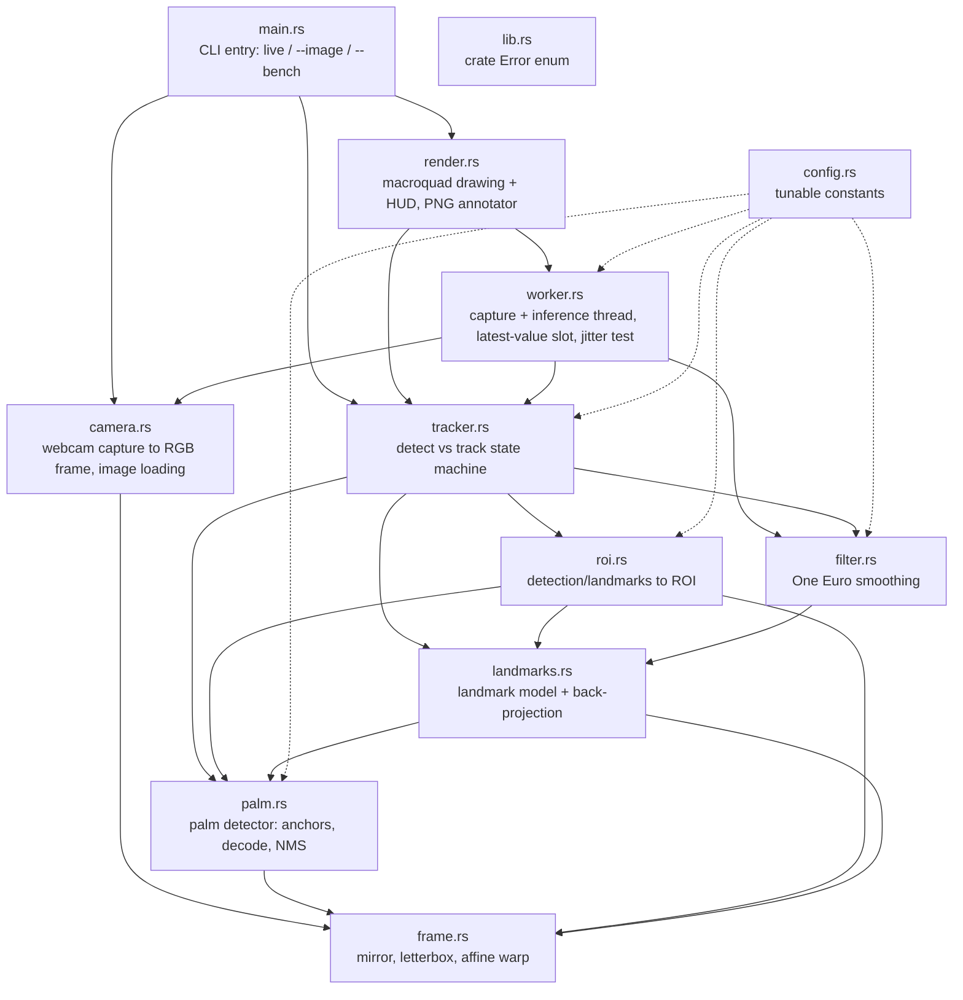

# handwave — Project Map

Native Rust app, webcam hand tracking. This file is the source of truth for
structure. Claude Code reads it first, updates it last, every milestone.

## Module graph

## Modules

- `src/main.rs` — clap CLI: live window (default), `--image <in> --out <png>`, `--bench`. Calls `camera::load_image`, `Tracker`, `render`.
- `src/lib.rs` — module list plus the single `Error` enum and `Result` alias. Used by every module.
- `src/config.rs` — every tunable constant (model sizes, anchor options, thresholds, ROI scales, filter defaults, window/camera sizes). Read by most modules.
- `src/camera.rs` — nokhwa/AVFoundation capture (permission wait, 1280x720 preferred) to `Frame`; `load_image` for files. Called by `worker` and `main`.
- `src/frame.rs` — PURE: `Frame`, `Rect`, `Affine`, mirror, letterbox rect, bilinear `warp_to_tensor`. Called by `palm`, `landmarks`, `roi`, `camera`, `render`.
- `src/palm.rs` — SSD anchors, decode, sigmoid, weighted NMS, letterbox removal (all pure) plus `PalmDetector` (ort session). Called by `tracker`; `roi` and `landmarks` use its `Detection` and `extract`.
- `src/roi.rs` — PURE: palm detection to ROI, landmarks to next ROI, rect IoU. Called by `tracker`.
- `src/landmarks.rs` — `Landmark` type, `LandmarkModel` (ort session) and `project_landmarks` back to frame pixels. Called by `tracker`; `filter` and `roi` use `Landmark`.
- `src/tracker.rs` — `Tracker`: tracked hands skip palm detection, detector runs while fewer than 2 hands, duplicate detections (IoU > 0.5) dropped, per-track filter reset on start. Called by `worker`, `main`.
- `src/filter.rs` — PURE: `OneEuroFilter`, `LandmarkFilter`, `rms_deviation`. Called by `tracker` and `worker`.
- `src/worker.rs` — worker thread (capture, mirror, track), `LatestSlot` mailbox, `Controls` (filter/jitter/quit flags), `Snapshot`, jitter test. Spawned by `render`.
- `src/render.rs` — macroquad live view and HUD (`run_live`), CPU `annotate` for `--image`. Called by `main`.
- `tests/parity.rs` — fixture parity (detect and track paths) against `tests/fixtures/expected/*.json`.
- `models/` — ONNX models (embedded with `include_bytes!`) and `MODELS.md`. `scripts/` — model conversion, reference landmarks, pinned Python requirements.

Differences from the first version of this map: `worker.rs` was added (not in the original structure list); `roi` depends on `landmarks`/`palm` for types (not the reverse); the error enum lives in `lib.rs`.

## Milestones

- M0 — native hand tracking: official MediaPipe models via ONNX Runtime, palm detect + landmark ROI tracking for 2 hands, One Euro filter, live macroquad view with HUD and jitter test, `--image` and `--bench`, fixture parity tests (worst mean error 0.0064), CI.
